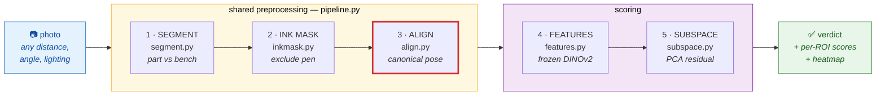
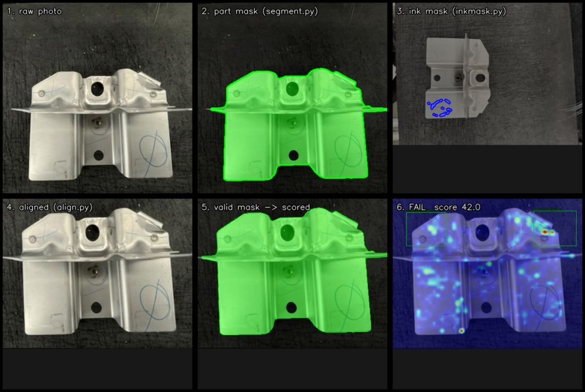
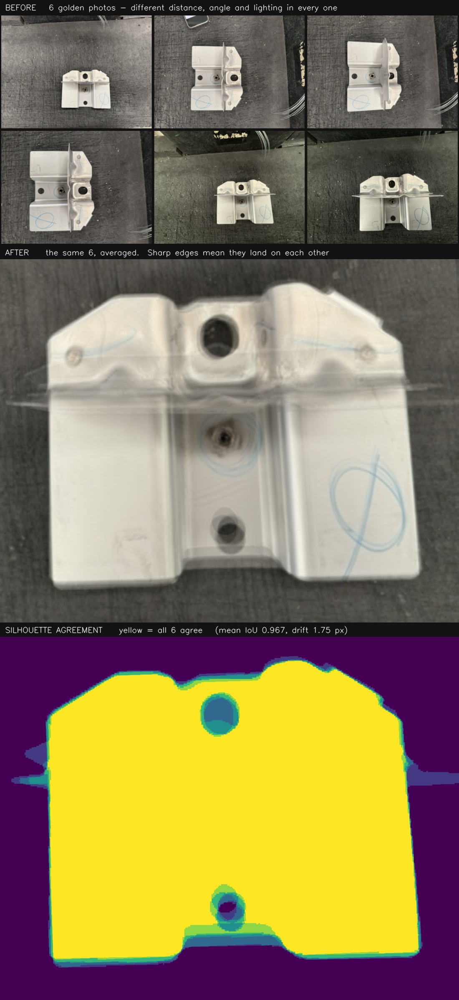
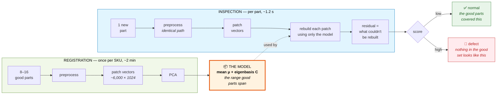
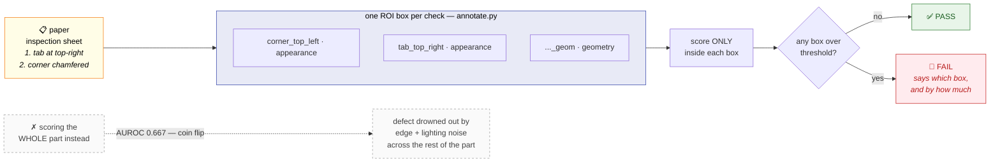

# Training-Free Defect Inspection

Visual inspection of stamped metal automotive brackets photographed at a manual
station — operator, phone camera, dark workbench, no fixture, no controlled
lighting.

---

## How it works

### The core idea in one paragraph

Show the system 8–16 photos of **good** parts. It learns what "normal" looks
like — not by training a network, but by measuring the range of appearance that
good parts span. Then any new part is scored by asking: *how much of this part
falls outside the range the good ones covered?* A scratch, a missing tab, a
bent flange — none of them were in that range, so they stick out. There is **no
gradient training anywhere** and **no defect examples are needed**.

### Why that requires more than "compare two photos"

Two photos of the same good part look wildly different — the operator stood
closer, rotated the part, the light moved. Comparing raw pixels would flag
every one of them. So most of this repo is the work of removing those
differences *before* any comparison happens.

### The pipeline, stage by stage



Stage 3 is outlined in red because it is load-bearing — see the warning below.

And here is that same pipeline on a real defective part from `test_images/`
(the one with the bent-up top-right tab):



Read it left to right, top to bottom: the raw photo, the part separated from
the bench, the blue pen traced and excluded, the part straightened onto the
canonical canvas, the mask that actually reaches the scoring, and finally the
anomaly heatmap. The hottest spot in panel 6 sits exactly on the bent tab,
inside the `tab_top_right` ROI box — the part failed for the right reason, not
by coincidence.

**1. Find the part** (`segment.py`)
Separate the bracket from the workbench, producing a black-and-white mask.
Two interchangeable backends: **BiRefNet** (a downloaded AI segmentation model,
more accurate) or **classical** (brightness + texture rules, no download).
Real stamped holes in the part are preserved; only segmentation speckle is
filled in.

**2. Mask the pen** (`inkmask.py`)
Operators mark inspected parts with a blue felt pen, and the marks land
somewhere different on every part. Unmasked, this becomes the single biggest
source of false alarms — every pen stroke is correctly "not like the good
parts". These pixels are excluded from scoring entirely.

**3. Straighten it** (`align.py`) — *the load-bearing stage*
Every part is warped onto a fixed-size canvas at the same position, rotation,
and scale. The part's centroid gives translation, its principal axis gives
rotation, its measured extent gives scale, and a refinement step absorbs mild
camera tilt. After this, the top-left corner of one photo sits on exactly the
same pixels as the top-left corner of every other photo.

> **If this stage fails, nothing downstream means anything.** A 3-pixel pose
> error means you're comparing the corner against the background, and a
> perfect part scores as badly as a defective one. That's why Experiment 1
> exists and why you run it first.

What that looks like when it works:



Six golden photos, every one framed differently. After alignment they average
into a *sharp* image — blur would mean they hadn't landed on each other — and
their silhouettes agree almost everywhere (solid yellow). The thin coloured
fringe at the edges is the residual disagreement, about 3 % of the area.

**4. Describe it** (`features.py`)
The aligned image goes through **DINOv2**, a frozen vision model, which is
carved into a grid of patches (about 38×48 here). Each patch becomes a
1024-number vector describing its texture and shape. The model is used purely
as a fixed measuring instrument — never fine-tuned. Patches less than 90%
inside the part mask are dropped, because half-part/half-background patches
wobble with every shot and would generate a halo of false alarms.

**5. Score it** (`subspace.py`)
This is the actual anomaly detection, and it's simpler than it sounds:

- Take all the patch vectors from the good parts and run **PCA** on them. The
  result is a "subspace" — a compact description of every way good parts are
  allowed to vary (lighting, highlight positions, minor surface differences).
- For a new part, try to rebuild each patch using only that subspace. Whatever
  can't be rebuilt is the **residual** — and that's the anomaly score.
- Normal patches rebuild almost perfectly (low score). A defect has no
  equivalent in any good part, so it rebuilds poorly (high score).

The entire "model" for a SKU is a mean vector and a set of eigenvectors — a
few megabytes, no weights, no training run.

Visually, that's:



**Two refinements that matter in practice.** Edges, holes, and stamped features
always score high even on flawless parts, so each patch position is
standardized against its own distribution across the good set. And a second
score (Mahalanobis) catches defects that lie *inside* the subspace but far from
its center — the residual alone would miss those.

### ROIs: the part that makes it actually work

Scoring the whole part **doesn't work well** — measured, not assumed:
whole-part AUROC was **0.667**, barely better than a coin flip. The defect is
real but drowned out by edge and lighting noise across the rest of the
silhouette.

Instead, draw a box around each check on your paper inspection sheet — "tab
must be present at top-right", "top-left corner must be chamfered" — and score
only inside those boxes. Same model, same features, just scoped. That takes
AUROC to **1.000**.



Two kinds of box:

| Type | What it does | Best for |
|---|---|---|
| **appearance** | DINOv2 + subspace residual inside the box | scratches, dents, wrong texture, missing marks |
| **geometry** | measures the silhouette directly — area, corner angles, fill ratio | missing tabs, wrong corner shape, bent flanges |

Geometry checks exist because a *missing* feature is the known weak spot of
this method — absent metal reads as ordinary background. Measuring the outline
answers that question directly and cheaply.

### Two stages of use

**Registration** (once per SKU, ~2 min): good photos → subspace → saved to
`data/models/<sku>/`.

**Inspection** (per part, ~1.2 s): one photo → same preprocessing → score each
ROI → verdict + heatmap.

Both run **the identical preprocessing code path** — one function,
`pipeline.preprocess()`, called by both. If they ever diverged, the model would
be comparing against something subtly different from what it learned.

### Three possible verdicts

| Verdict | Shown to operator | What it means |
|---|---|---|
| **PASS** | ผ่าน | every sheet check is within limits |
| **FAIL** | ไม่ผ่าน | a sheet check failed — the report names which and by how much |
| **RETAKE** | จัดชิ้นส่วนให้อยู่ในพื้นที่ | the part runs off the frame edge — the photo is unusable |

**RETAKE is not FAIL.** A clipped photo tells you nothing about the part.
Calling it a defect would send an operator to scrap a part that was never
actually inspected.

**Scope is the inspection sheet, nothing else.** A separate station upstream
catches general defects — dents, scratches, damage. So a big scratch that
isn't on the sheet is deliberately out of scope here, and this system stays
silent about it.

---

## Setup

```bash
conda env create -f environment.yml
conda activate defect-detection
```

Verify the GPU was picked up:

```bash
python -c "import torch; print('cuda', torch.cuda.is_available())"
```

If that prints `False`, the CPU-only wheel was installed:

```bash
pip install --force-reinstall --extra-index-url https://download.pytorch.org/whl/cu124 torch==2.6.0+cu124 torchvision==0.21.0+cu124
```

First run downloads BiRefNet (~900 MB) and DINOv2 ViT-L (~1.1 GB). Both are
cached afterwards. CPU-only works but is roughly 10× slower.

---

## Run

### Step 1 — check alignment holds

```bash
python -m experiments.exp1_alignment_repeatability --sku 8983864641
```

Aligns every photo and reports overlap (IoU) and centroid drift against the
reference, ending in **PASS** or **FAIL**. Writes visual proof to
`outputs/exp1/<sku>/` — in `aligned_agreement.png`, solid yellow means every
photo agrees on the outline.

**Run this first.** It takes ~2 minutes and tells you whether any other number
is worth reading. Read-only; changes nothing.

### Step 2 — register the SKU

```bash
python -m inspector.register --sku 8983864641 --segmenter birefnet
```

Fits the subspace from `normal_images/<sku>/` and saves the model. Reports
valid patch count, retained components `r`, fit time, and the range of scores
the good parts produced — your threshold has to sit above that maximum.

Also screens the good set for contamination: each candidate is scored against a
subspace built from the others, and outliers are flagged. One defective "good"
part would hide its own defect permanently.

### Step 3 — draw the ROI boxes

```bash
python -m inspector.annotate --sku 8983864641          # drag boxes in a window
python -m inspector.annotate --sku 8983864641 --list   # show current boxes
```

Drag a box, type a name, pick appearance or geometry. This is configuration,
not labeling — minutes per SKU, no defect examples needed. Re-run register
afterwards so geometry nominals get measured.

Both sample SKUs already have their boxes set from the inspection sheets.

### Step 4 — inspect

```bash
# one part
python -m inspector.inspect --sku 8983864641 --image part.jpg --out result/

# a whole folder, with a CSV summary
python -m inspector.inspect --sku 8983864641 --dir test_images/8983864641 --csv results.csv
```

Prints verdict and per-ROI scores; writes a stage strip per image showing
raw → mask → ink → aligned → heatmap.

### Or use the UI

```bash
python demo.py
```

Opens at `http://127.0.0.1:7860`. Four tabs: upload reference images and fit;
define ROIs (or pick "whole part" to see the baseline fail); upload a test
image; read the verdict, scores, heatmap, and every intermediate stage.

The sidebar exposes every knob that changes a result — backbone, resolution,
PCA threshold, aggregation, position normalization, ink masking, **alignment
on/off**, segmenter, threshold.

Changing the test image **never refits**. Fit is the slow part (~105 s);
inspection is ~1.2 s, and that's the number representative of production cost.
The UI reports them separately so they don't get conflated.

> The UI's ROI tab takes typed coordinates (`id, type, x, y, w, h`), not
> mouse-drag — Gradio doesn't cleanly return box coordinates. Drag-to-draw
> lives in `inspector.annotate` instead.

### Worth trying in the UI

- Turn **alignment off** → watch the failure mode the whole design guards against
- Switch ROI mode to **whole part** → AUROC collapses 1.000 → 0.867
- Switch aggregation to **top-1% TVaR** → watch small defects get averaged away
- Turn **ink masking off** → watch pen strokes become the top anomaly

---

## Start testing in 5 minutes

Both sample SKUs are already registered, so you can see results immediately —
no setup beyond the conda environment.

### Just show me it working

```bash
python -m inspector.inspect --sku 8983864641
python -m inspector.inspect --sku 8983980631
```

Prints a verdict per image in about 20 seconds (after the one-time model
download). Then open `outputs/inspect/<sku>/` — one PNG per part showing
raw → mask → ink → aligned → heatmap. **Look at the heatmaps**: on a FAIL the
hot spot should sit on the actual defect. If it doesn't, the verdict is right
by luck and shouldn't be trusted.

### Prove it isn't cheating

```bash
python -m experiments.exp1_alignment_repeatability --sku 8983864641   # must PASS
python -m experiments.exp2_roi_vs_fullframe --sku 8983864641          # the go/no-go
python -m experiments.exp3_threshold_sweep --sku 8983864641           # where to set the threshold
python -m experiments.exp5_reference_count_sweep --sku 8983864641     # how many golden images
```

Run Experiment 1 first — if alignment fails, every other number is noise.

### Feel the knobs

```bash
python demo.py
```

Upload golden images → **Fit subspace** (~2 min) → upload a test image →
**Inspect** (~1 s). Refitting only happens when the reference set or the
backbone/resolution/tau changes, so you can flip through test images freely.

**Full walkthrough of every tab and control: [docs/DEMO_GUIDE.md](docs/DEMO_GUIDE.md).**

Start by turning **alignment off** and inspecting again. Watching the good
parts light up is the fastest way to understand why the pipeline is shaped the
way it is.

### Test your own parts

1. Drop 8–16 good photos in `normal_images/<sku>/` — **vary the lighting**,
   don't just take more shots of the same setup.
2. `python -m experiments.exp1_alignment_repeatability --sku <sku>` → must PASS
   before anything else is meaningful.
3. `python -m inspector.register --sku <sku> --segmenter birefnet`
4. `python -m inspector.annotate --sku <sku>` → drag one box per check on your
   inspection sheet, name it, pick appearance or geometry.
5. `python -m inspector.register --sku <sku> --segmenter birefnet` again, so
   geometry nominals get measured for the new boxes.
6. Drop test photos in `test_images/<sku>/` and inspect.

To get a real threshold rather than the default, label a few test images in
`data/labels/<sku>.csv` (`image,label` — 1 = NG) and run Experiment 3.

### If something looks wrong

| Symptom | Likely cause |
|---|---|
| Everything FAILs | golden set too small or too uniform — check the fit warnings |
| Scores unstable, one patch spikes | ROI holds too few patches → raise `input_size` for that SKU |
| Good parts flagged | threshold below the golden max, or lighting not covered by the golden set |
| Alignment PASS but bad heatmaps | check the ink mask — pen strokes read as anomalies if missed |
| `cuda False` | CPU-only torch installed; see Setup |

The fit output always reports **valid patch count** and **retained components
`r`**. When behaviour is odd, those two numbers usually explain it.

---

## Results on the sample data

**All 15 test images across both SKUs classify correctly**, against ground
truth supplied by QC.

### SKU 8983864641 — tab present, corner chamfered

Six good images, nine test images, three NG. Threshold 12.0.

| Image | Truth | Verdict | Score |
|---|---|---|---|
| image_1 | NG (tab missing) | FAIL | 13.14 |
| image_2 | NG (corner square) | FAIL | 18.76 |
| image_3 | good part, bad photo | RETAKE | — |
| image_4 | NG (bent flap) | FAIL | 41.99 |
| image_5–9 | OK | PASS | 4.8–11.0 |

### SKU 8983980631 — Mark RH present

Four good images, six test images, four NG. Threshold 20.0, `input_size` 1120.

| Image | Truth | Verdict | Score |
|---|---|---|---|
| image_1–3 | NG (mark missing/holed) | FAIL | 68.9–90.3 |
| image_4 | OK for this station* | PASS | 9.6 |
| image_5–6 | OK | PASS | 3.0–8.3 |

Golden parts score **1.49** here, so the NG margin is roughly 46×.

\* image_4 has a real defect on its left side, but no sheet check covers
that region — the upstream station's job, not this one's.

### Experiments

| Experiment | Result |
|---|---|
| 1 — alignment repeatability | **PASS** — mean IoU 0.967, drift 1.75 px (criterion: IoU > 0.95, drift < 5 px) |
| 2 — ROI vs whole part vs full frame | **ROI AUROC 1.000** vs whole-part 0.867 vs full-frame 0.556 |
| 3 — threshold sweep | 100% recall at **0% false-call rate** |
| 4 — specular sensitivity | **not run** — needs the varied-lighting photo set |
| 5 — reference count | at k=3, **varied images AUROC 1.000, near-duplicates 0.333** |

Experiment 2 is the go/no-go, and it's unambiguous: **ROI cropping is what
makes this work.**

Segmenter comparison — BiRefNet IoU 0.967 / drift 1.75 px (passes) vs
classical 0.935 / 4.66 px (fails). The download earns its place.

### Two things the sample data taught us

**Resolution beats box tuning.** On SKU 8983980631 the Mark RH box held only
~16 patches at the 672 default, so the verdict rode on the single worst patch
— and a good part scored 12.6 against a defective one at 17.6, the same
profile one noisy patch apart. Three different box sizes gave *identical*
results, because the canvas is 438 px tall and the differences were smaller
than one patch. Raising that SKU to `input_size` 1120 gave 27–50 patches and
turned the margin into 46×. Hence the per-SKU `input_size` override.

**Coverage beats count.** At the same k=3 golden images, deliberately varied
lighting gave AUROC 1.000 while near-duplicates gave 0.333 — worse than
chance. When collecting golden sets, vary the lighting and highlight
positions; don't just take more shots of the same setup.

---

## The five design rules, and where they live

These make or break accuracy, so they're enforced in code rather than comments.

1. **One preprocessing path.** [`pipeline.preprocess()`](inspector/pipeline.py)
   is the only implementation; registration and inspection both call it. No
   second copy exists to drift out of sync.
2. **The mask reaches the scoring.** [`features.patch_mask_from_pixel_mask()`](inspector/features.py)
   drops any patch less than 90% inside the valid mask — from the PCA fit *and*
   from test scoring. Greying out the background isn't enough.
3. **No per-image min-max normalization.** Scores are raw residuals. The only
   standardization is against per-position statistics measured once at
   registration — a fixed transform, so a fixed threshold stays meaningful.
   Heatmap color scales anchor on the threshold, never on the image's own range.
4. **Rotation augmentation off by default** (`n_aug = 0`). Alignment handles
   pose; random rotations only widen the subspace and hide defects.
5. **Aggregation is `max` or top-3 mean**, not top-1% TVaR. These defects are
   tiny relative to their ROI, and averaging over the top 1% dilutes them back
   into the noise. TVaR is available in the UI for comparison.

---

## Layout

```
inspector/
  config.py      every knob that changes a result
  segment.py     BiRefNet or classical segmentation -> part mask
  inkmask.py     blue marker-pen exclusion
  align.py       canonical pose normalisation  <- the load-bearing module
  pipeline.py    THE shared preprocessing path
  features.py    frozen DINOv2 patch features
  subspace.py    PCA fit, residual + Mahalanobis scoring, contamination screen
  geometry.py    silhouette measurements for shape checks
  roi.py         SKU config and ROI definitions
  register.py    stage 1 - build a SKU model
  inspect.py     stage 2 - score a part
  annotate.py    draw ROI boxes
  viz.py         overlays, heatmaps, contact sheets
demo.py          Gradio experimentation UI
experiments/     exp1..exp5 plus check_stages.py
data/
  models/<sku>/      sku.json + model.npz + reference images
  labels/<sku>.csv   ground truth for the test set (image,label; 1 = defective)
  specular/<sku>/    good-part photos with varied lighting, for Experiment 4
normal_images/<sku>/   good photos + IS_*.jpg inspection sheet
test_images/<sku>/     parts to inspect
outputs/               everything the scripts write
```

---

## Adding a new SKU

1. Put 8–16 good-part photos in `normal_images/<sku>/` — **deliberately varied
   lighting and highlight positions**, not near-duplicates (see below).
2. `python -m experiments.exp1_alignment_repeatability --sku <sku>` → must PASS.
3. `python -m inspector.register --sku <sku> --segmenter birefnet`
4. `python -m inspector.annotate --sku <sku>` → one box per inspection-sheet check.
5. Re-run register so geometry nominals get measured.
6. Label some test images in `data/labels/<sku>.csv`, then run Experiment 3 to
   pick a threshold from data instead of guessing.

---

## Notes and caveats

**This codebase assumes one part per photo, photographed close up.** The real
station photographs a 600 × 1400 mm area with many parts of the same SKU laid
out at once, which this pipeline does not yet handle — segmentation keeps only
the largest component, so the other parts would be silently discarded. That
gap, and the camera resolution needed to keep the small-mark checks working at
station distance, are written up in
[docs/PRODUCTION_NOTES.md](docs/PRODUCTION_NOTES.md). **Read that before
specifying station hardware** — 4K is the minimum that preserves the accuracy
shown here, and it is not a software-fixable choice.

**The labels are provisional.** `data/labels/8983864641.csv` was read off the
aligned corner crops by eye against the inspection sheet, not supplied by QC.
Every accuracy number above rests on it. Replace it with real verdicts before
quoting anything externally.

**The sample size is small.** Two defective and six good parts. AUROC 1.000 on
eight images means the method separates *these* defects cleanly — read it as
"no overlap yet", not "solved".

**The subspace is still starving at k=6.** Experiment 5 shows the mean test
score falling 342 → 115 → 21 as k goes 1 → 2 → 4, with no sign of a plateau.
More good images should lower absolute scores and widen the margin. The
expected useful range of 8–16 looks right; we can't yet reach it.

**Coverage beats count, measurably.** At the same k=3, deliberately varied
images gave AUROC 1.000 while near-duplicates gave 0.333 — worse than chance.
This is the most actionable finding for how to collect good-part sets: vary the
lighting and highlight positions, don't just take more shots.

**Specular sensitivity is untested.** Experiment 4 has no data, and it's the
predicted dominant failure mode. Photograph one good part ~20 times with the
light and camera deliberately moved, drop them in `data/specular/<sku>/`, and
run it. If it fails, the fixes in priority order are: more good images covering
highlight positions, per-position normalization, a polarizing filter, then a
diffused light source at the station.

**SKU 8983980631 is registered but unvalidated.** Alignment passes (IoU 0.986,
drift 0.34 px) and the `mark_rh` ROI sits on the stamp, but there are no test
images yet. That check is the hardest in the set — a low-contrast raised stamp
only about four DINOv2 patches wide at 672 px input. If recall is poor, the
fallbacks are tiling the ROI or moving that check to classical template
matching.

**Two ECC rejections per fit are expected.** The homography refinement is
validated by corner displacement and falls back to the similarity transform
when it diverges. The warning is the safety net working, not a failure.

**Geometry checks are the right tool for silhouette defects.** A missing or
bent tab is a "logical anomaly" — this method's documented weak spot. The
geometry ROIs measure the aligned mask contour directly and caught the corner
defect independently of the appearance score.
